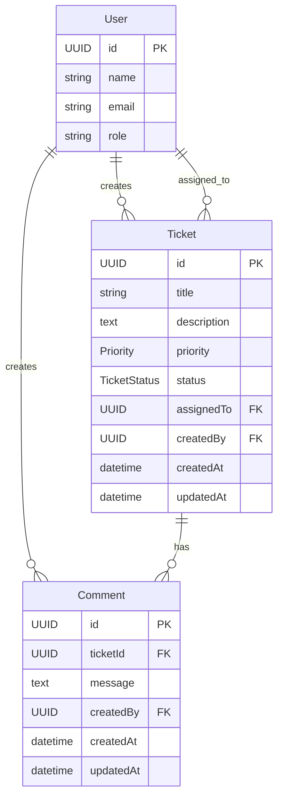

# Data Model

> **Purpose:** Defines the database structure for the Support Ticket Management System.

---

# Overview

The Support Ticket Management System uses a relational PostgreSQL database with three core entities:

- User
- Ticket
- Comment

The database is implemented using Prisma ORM and managed through Prisma Migrate. The model supports ticket lifecycle management, assignment, commenting, search, and filtering while maintaining referential integrity through foreign key constraints.

---

# Entity Relationship Diagram



---

# Entity Definitions

## User

**Purpose**

Represents a pre-seeded internal user who can create tickets, be assigned tickets, and add comments.

| Attribute | Type | Required | Notes |
|-----------|------|----------|------|
| id | UUID | Yes | Primary Key |
| name | VARCHAR | Yes | |
| email | VARCHAR | Yes | |
| role | VARCHAR | Yes | |
| createdAt | TIMESTAMP | Yes | Default: now() |

---

## Ticket

**Purpose**

Represents a support request throughout its lifecycle.

| Attribute | Type | Required | Notes |
|-----------|------|----------|------|
| id | UUID | Yes | Primary Key |
| title | VARCHAR(255) | Yes | |
| description | TEXT | Yes | |
| priority | Enum | Yes | |
| status | Enum | Yes | Default: Open |
| assignedTo | UUID | No | FK → User |
| createdBy | UUID | Yes | FK → User |
| createdAt | TIMESTAMP | Yes | |
| updatedAt | TIMESTAMP | Yes | |

---

## Comment

**Purpose**

Represents a user comment attached to a ticket.

| Attribute | Type | Required | Notes |
|-----------|------|----------|------|
| id | UUID | Yes | Primary Key |
| ticketId | UUID | Yes | FK → Ticket |
| message | TEXT | Yes | |
| createdBy | UUID | Yes | FK → User |
| createdAt | TIMESTAMP | Yes | |
| updatedAt | TIMESTAMP | Yes | |

---

# Relationships

| Relationship | Cardinality |
|--------------|-------------|
| User → Ticket (createdBy) | One-to-Many |
| User → Ticket (assignedTo) | One-to-Many (Optional) |
| Ticket → Comment | One-to-Many |
| User → Comment | One-to-Many |

Foreign key constraints ensure referential integrity between related entities.

---

# Enumerations

## Ticket Status

| Value |
|-------|
| Open |
| In Progress |
| Resolved |
| Closed |
| Cancelled |

**Valid transitions**

```text
Open → In Progress
In Progress → Resolved
Resolved → Closed
Open → Cancelled
In Progress → Cancelled
```

Closed and Cancelled are terminal states.

---

## Priority

| Value |
|-------|
| Low |
| Medium |
| High |
| Critical |

Priority is required during ticket creation and may be updated later.

---

# Database Constraints

## Primary Keys

- User.id
- Ticket.id
- Comment.id

## Foreign Keys

| Table | Column | References |
|-------|--------|------------|
| Ticket | createdBy | User.id |
| Ticket | assignedTo | User.id |
| Comment | ticketId | Ticket.id |
| Comment | createdBy | User.id |

## Default Values

| Column | Default |
|--------|---------|
| Ticket.status | Open |
| assignedTo | NULL |
| createdAt | now() |
| updatedAt | now() |

---

# Indexing Strategy

| Index | Purpose |
|-------|---------|
| Ticket.status | Status filtering |
| Ticket.assignedTo | Assigned ticket lookup |
| Ticket.createdBy | Creator lookup |
| Ticket.title | Keyword search |
| Ticket.createdAt | Sorting |
| Comment.ticketId | Retrieve comments for a ticket |

Primary keys are automatically indexed.

---

# Data Integrity Rules

- Validation is performed in the service layer before database operations.
- Foreign keys enforce referential integrity.
- Status transitions follow the defined workflow.
- IDs and timestamps are generated by the server.
- Terminal ticket states cannot change status.
- Enum values prevent invalid status and priority values.

---

# Prisma Mapping

The database schema is implemented using Prisma ORM.

| Prisma Model | Database Table |
|--------------|----------------|
| User | users |
| Ticket | tickets |
| Comment | comments |

Prisma Migrate manages all schema changes and Prisma Client provides type-safe database access.

---

# Migration & Seed Strategy

- Prisma Migrate manages schema evolution.
- Seed scripts create sample users.
- Optional sample tickets and comments support testing.
- Environment configuration is provided through `DATABASE_URL`.

---

# Future Enhancements

- Attachments
- Audit logs
- Soft deletes
- Categories
- Tags
- SLA tracking
- Full-text search
- User authentication