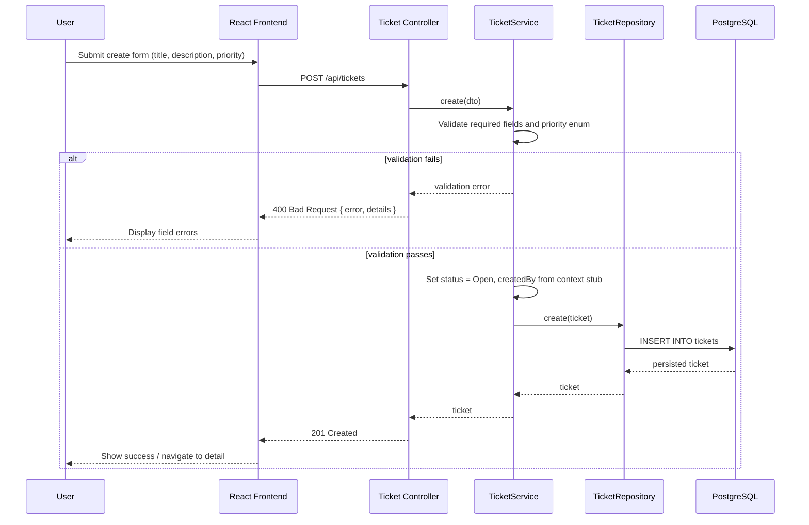
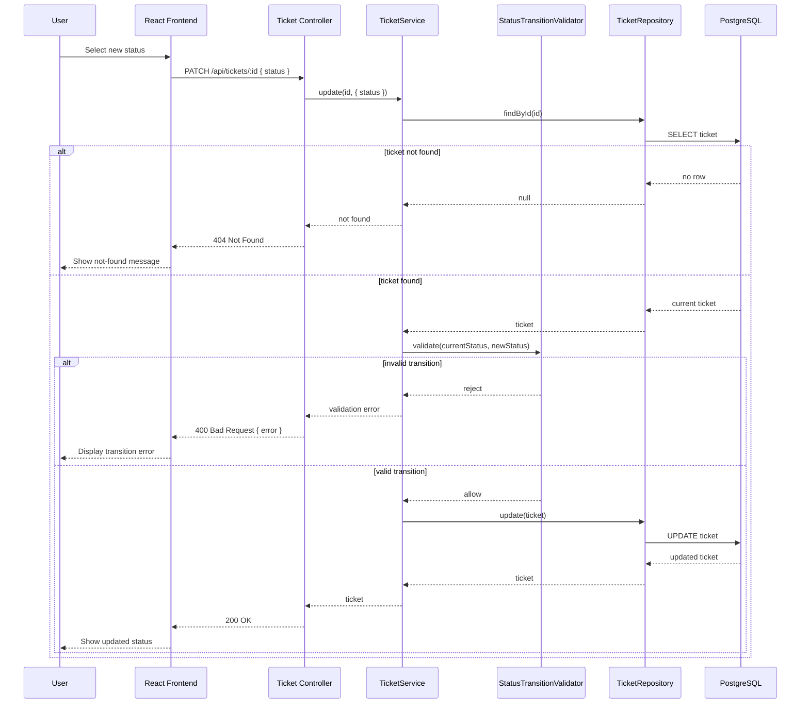
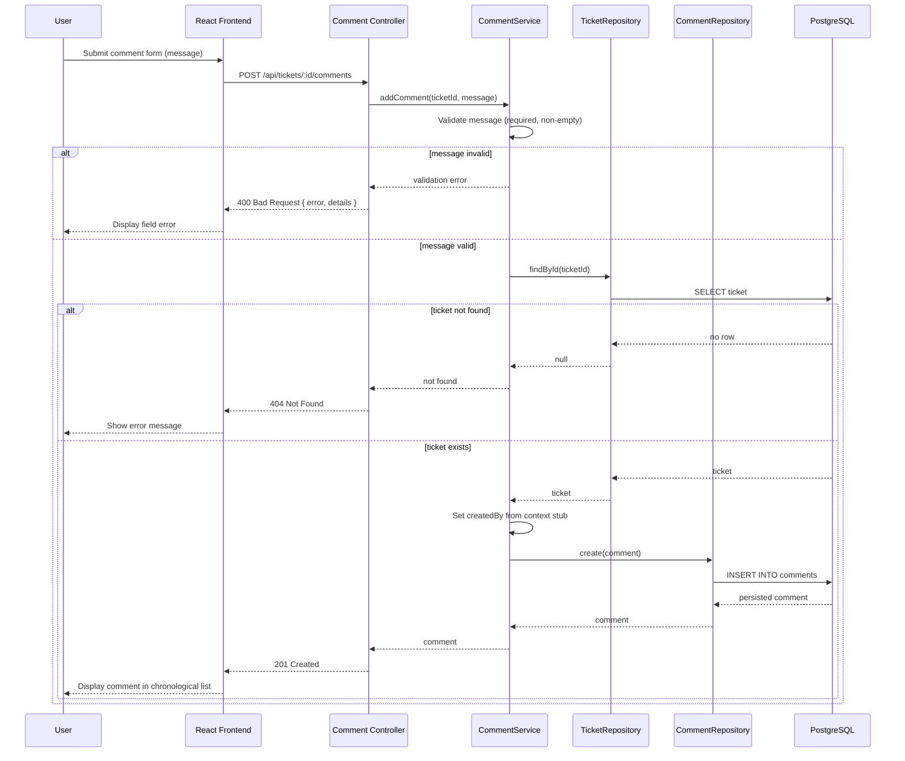

# Design Notes — Support Ticket Management System

> **Purpose:** Implementation-focused design decisions for the Support Ticket Management System. This document synthesizes [requirement-analysis.md](requirement-analysis.md), [acceptance-criteria.md](acceptance-criteria.md), [implementation-plan.md](implementation-plan.md), and the Cursor workflow files ([spec.md](tool-specific/cursor-workflow/spec.md), [project-context.md](tool-specific/cursor-workflow/project-context.md)).
>
> **Scope authority:** If conflicts arise, [acceptance-criteria.md](acceptance-criteria.md) governs scope; [requirement-analysis.md](requirement-analysis.md) governs business rules.

---

## 1. Architecture Overview

### 1.1 System Shape

The application is a **backend-heavy, full-stack** system for internal users to manage support tickets across their lifecycle. It follows a classic **layered architecture** with a clear separation between presentation, API, business logic, and persistence.

```
┌─────────────────────────────────────────────────────────┐
│                    Frontend (React)                      │
│  Pages: List | Detail | Create/Edit | Search/Filter     │
└─────────────────────────┬───────────────────────────────┘
                          │ HTTP (JSON) — REST API
┌─────────────────────────▼───────────────────────────────┐
│                  API Layer (Controllers)                 │
│  Request parsing, HTTP status mapping, error responses   │
└─────────────────────────┬───────────────────────────────┘
                          │
┌─────────────────────────▼───────────────────────────────┐
│                 Service Layer (Business Logic)           │
│  Status transitions, validation, orchestration           │
└─────────────────────────┬───────────────────────────────┘
                          │
┌─────────────────────────▼───────────────────────────────┐
│              Repository Layer (Data Access)              │
│  CRUD, queries, search/filter                            │
└─────────────────────────┬───────────────────────────────┘
                          │
┌─────────────────────────▼───────────────────────────────┐
│                   PostgreSQL Database                    │
└─────────────────────────────────────────────────────────┘
```

### 1.2 Technology Choices

| Layer | Technology | Rationale |
|-------|------------|-----------|
| Frontend | React + JavaScript + Vite | Component-based UI suited to forms, lists, and error display; Vite provides fast dev feedback. JavaScript (no TypeScript) matches project constraints while keeping the frontend approachable. |
| Backend | Node.js + Express + TypeScript | Express is lightweight and maps cleanly to REST endpoints. TypeScript strengthens typing for business rules—especially the status transition matrix—where runtime errors are costly. |
| Database | PostgreSQL | Relational model fits tickets, users, and comments with foreign-key integrity. Mature, reliable, and well-supported for production-style persistence. |
| ORM | Prisma | Declarative schema, versioned migrations, seed scripts, and type-safe client generation reduce schema drift and simplify repository implementation. |
| API style | REST + JSON | Straightforward CRUD mapping, predictable HTTP status codes, and easy integration testing with Supertest. |
| Testing | Vitest + Supertest (backend API integration tests); Vitest + React Testing Library (frontend component/UI tests) | Backend tests exercise the real HTTP layer against a running API; frontend tests validate rendered UI, routing, and error display without duplicating business-rule enforcement. |
| API docs | OpenAPI (Swagger) | Meets documentation acceptance criteria and provides a stable contract for frontend integration. |

### 1.3 Layer Responsibilities

| Layer | Owns | Must not own |
|-------|------|--------------|
| **Controllers** | HTTP request/response mapping, DTO shaping, status code selection, delegating to services | Business rules, database queries, validation logic |
| **Services** | Validation, status transitions, assignee checks, orchestration across repositories | HTTP concerns, raw SQL/ORM query construction |
| **Repositories** | Persistence queries (CRUD, search, filter) | Business logic, HTTP mapping |
| **Frontend** | UX, forms, navigation, displaying API errors, UX hints for valid next statuses | Authoritative enforcement of workflow rules |

**Why backend as source of truth:** Status transitions are the highest-risk domain logic. If the frontend enforces rules independently, a direct API call or a UI bug could bypass workflow constraints. Centralizing rules in the service layer ensures consistent enforcement regardless of client.

### 1.4 Project Structure

The codebase uses a **two-folder layout** (`backend/`, `frontend/`) within a monorepo-style root:

- **Backend:** TypeScript, Express, Prisma Client, layered modules (controllers, services, repositories, validators, middleware).
- **Frontend:** JavaScript React app with Vite, client-side routing, and a shared API client utility.

This structure supports **vertical-slice delivery**: each milestone delivers database changes, API endpoints, UI screens, and tests together rather than completing all backend work before any frontend work.

### 1.5 Delivery Model and Critical Path

Development proceeds in phases M0–M7:

1. Foundation (schema, migrations, seed, health check, error handling shell)
2. Ticket creation
3. Listing and detail views
4. Field updates and assignment
5. **Status transition engine** (critical path — highest defect risk)
6. Comments
7. Search and filter
8. Hardening, documentation, regression

**Why status transitions come after CRUD:** Field updates and assignment are independent of the workflow engine. Implementing and testing CRUD first establishes stable API conventions; the status engine can then be added as an isolated, heavily tested module without rework on earlier features.

### 1.6 Scope Boundaries

**In scope:** Ticket CRUD, status workflow, comments (add/view), search/filter, pre-seeded users, backend validation, integration tests, documentation.

**Out of scope:** Authentication/authorization, user management, ticket/comment deletion, comment editing (app feature), assignment history, audit logs, pagination (stretch goal).

**Resolved decisions:**

| Question | Decision | Rationale |
|----------|----------|-----------|
| Unique ticket titles? | Not required | Not in acceptance criteria |
| Priority editable after creation? | Yes | Update explicitly includes priority |
| Edit Closed/Cancelled tickets? | Allow field updates; block status changes | Preserves data integrity while meeting update criteria |
| Empty search keyword? | No text filter applied | Avoids accidental empty-result queries |
| Concurrent updates? | Last write wins | No optimistic locking required by spec |

### 1.7 Design Principles

The following architectural principles guided every design decision in this project. They align with the layered structure described above and with the coding principles in [project-context.md](tool-specific/cursor-workflow/project-context.md).

#### Separation of Concerns

Each layer handles a distinct category of responsibility. The frontend manages presentation and user interaction; controllers handle HTTP; services own business rules; repositories own data access. Mixing concerns—for example, embedding status transition logic in a controller or SQL in a service—makes the system harder to test and change.

**Application:** A status change request flows through the controller (HTTP), service (validation), and repository (persistence) as separate steps. No layer skips ahead or absorbs another layer's job.

#### Single Responsibility Principle

Each module does one thing well. `StatusTransitionValidator` only evaluates whether a transition is allowed. `TicketRepository` only reads and writes ticket records. `TicketService` orchestrates validation and persistence but does not format HTTP responses.

**Application:** When the status workflow changes, only the validator and its tests need updating—not the repository, controller, or frontend error display logic.

#### Backend as Source of Truth

All business rules—required fields, priority enums, assignee existence, status transitions—are enforced in the backend service layer. The frontend may provide UX hints (e.g., showing only valid next statuses) but never acts as the sole gatekeeper.

**Application:** A direct API call with an invalid transition (e.g., `Open` → `Closed`) is rejected with `400` even if the UI would not have offered that option. Integration tests verify this at the HTTP boundary.

#### Layered Architecture

Dependencies flow in one direction: Frontend → Controller → Service → Repository → Database. Inner layers never depend on outer layers. This creates clear boundaries, predictable call paths, and natural test seams.

**Application:** Repositories use Prisma Client directly; services call repositories through interfaces or module imports; controllers call services and map results to HTTP. The frontend never accesses the database.

#### Reusable Components

Shared building blocks reduce duplication and enforce consistency. On the backend, this includes the global error handler, validation helpers, and the status transition validator. On the frontend, this includes the API client utility, form error display patterns, and common UI elements (assignee dropdown, status control).

**Application:** Every form that calls the API uses the same client to parse `{ error, details }` responses. Every endpoint returns errors through the same global handler shape.

#### Maintainability

The design favors clarity and testability over cleverness. Pure functions for high-risk logic, versioned Prisma migrations, documented environment variables, and incremental vertical-slice delivery all reduce the cost of future changes.

**Application:** A new developer can trace a ticket creation request from the React form through the controller, service, repository, and database without ambiguity. Business rules are documented, tested, and located in predictable places.

### 1.8 Key Interaction Flows

The sequence diagrams below illustrate how requests flow through the layered architecture for three core operations. Error paths are shown where they are most relevant to the design.

#### Ticket Creation



#### Ticket Status Update



#### Add Comment



---

## 2. Frontend Design

### 2.1 Framework and Tooling

The frontend is a **single-page application** built with React and Vite. React is chosen for its component model, which maps naturally to discrete screens (list, detail, create) and reusable form elements. Vite provides fast hot-module replacement during development.

JavaScript is used intentionally (no TypeScript on the frontend) per project requirements. Type safety for API contracts is enforced on the backend and documented via OpenAPI rather than compile-time frontend checks.

### 2.2 Routing and Pages

| Route / Screen | Purpose |
|----------------|---------|
| Ticket list | Display all tickets with required columns; search input; status filter dropdown |
| Ticket detail | Full ticket info; edit form; status control; comment list and add form |
| Create ticket | Form for title, description, priority with validation error display |

Navigation flow: **list → detail → back to list**. Optional enhancement: preserve search/filter state in URL query parameters for shareable list views (stretch goal, not required for acceptance).

### 2.3 API Client

A shared **API client utility** centralizes:

- Base URL configuration (from environment variable)
- JSON request/response handling
- Consistent parsing of error response bodies (`error`, `details`)
- Network failure handling (timeouts, connection errors)

**Why a shared client:** Avoids duplicating fetch logic across forms and pages; ensures all screens parse the backend error format consistently.

### 2.4 Component Design

| Area | Design approach |
|------|-----------------|
| **Ticket list** | Table or card layout showing title, priority, status, assignee name, created date, updated date. Click row/card navigates to detail. |
| **Search & filter** | Controlled inputs bound to list query parameters. Debouncing search input is optional but improves UX for keyword queries. |
| **Create / edit forms** | Controlled form fields with inline or banner display of field-level validation errors from API `details` array. |
| **Assignee selector** | Dropdown populated from `GET /api/users`. Includes an "Unassigned" option mapped to `null`. |
| **Status control** | Dropdown or button group showing only **valid next statuses** as a UX convenience. Backend still validates every transition. |
| **Comments** | Chronological list (oldest first) on detail page; simple textarea + submit for new comments. |

### 2.5 State Management

Local component state and React hooks are sufficient for this application's scope. No global state library (Redux, Zustand) is required because:

- Pages are largely independent (list fetches on mount; detail fetches by ID).
- No authentication/session state to manage.
- Filter state can live in URL params or component state.

**Why avoid over-engineering:** The acceptance criteria do not require real-time updates, optimistic UI, or complex cross-page state. Keeping state local reduces complexity and aligns with the minimal-scope principle.

### 2.6 Error Display

The frontend must surface errors at three levels:

1. **Field-level validation (400):** Map `details[].field` and `details[].message` to form fields.
2. **Business rule failures (400):** Display summary `error` message (e.g., invalid status transition) prominently on the detail page.
3. **Resource not found (404):** Show a user-friendly "ticket not found" message with navigation back to list.
4. **Server/network failures (500, network):** Global error banner or toast; no stack traces or internal details shown to users.

**Why display backend messages verbatim:** The backend is the authority on business rules. Paraphrasing error messages risks inconsistency; displaying API messages ensures users see the same rejection reason the server enforced.

### 2.7 Frontend Must Not Enforce Workflow Rules

The status control may **hint** at valid next statuses by reading the current status and filtering options client-side. However:

- The frontend must never block API calls based on its own transition logic as the sole guard.
- Invalid transitions attempted via API must still be rejected and displayed.
- This design allows the status matrix to change in one place (backend validator) without frontend logic drift.

---

## 3. Backend Design

### 3.1 Framework and Module Layout

Express serves as the HTTP framework. The backend is organized into:

| Module | Responsibility |
|--------|----------------|
| **Routes** | Wire HTTP methods and paths to controllers |
| **Controllers** | Parse request, call service, map result to HTTP response |
| **Services** | Business logic, validation, orchestration |
| **Repositories** | Prisma-based data access |
| **Validators** | Pure functions for status transitions and reusable validation |
| **Middleware** | Global error handler, request validation, optional request context stub |
| **Types/DTOs** | Request and response shapes for API contracts |

### 3.2 API Surface

Base path: `/api`. All endpoints return JSON.

| Method | Endpoint | Purpose |
|--------|----------|---------|
| `GET` | `/api/health` | Application and database connectivity check |
| `GET` | `/api/users` | Read-only list of seeded users (assignee dropdown) |
| `POST` | `/api/tickets` | Create ticket (defaults to `Open`) |
| `GET` | `/api/tickets` | List tickets with optional `search` and `status` query params |
| `GET` | `/api/tickets/:id` | Full ticket detail including comments |
| `PATCH` | `/api/tickets/:id` | Update fields, assignee, and/or status |
| `POST` | `/api/tickets/:id/comments` | Add comment to ticket |

**Why PATCH for updates:** Partial updates allow clients to send only changed fields. Status changes share the same endpoint (or optionally a dedicated status sub-route) but always pass through the transition validator.

### 3.3 Service Layer Design

Each domain area has a dedicated service:

| Service | Key operations |
|---------|----------------|
| **TicketService** | `create`, `getById`, `list`, `update`, `updateStatus` |
| **CommentService** | `addComment` |
| **UserService** | `listUsers` (read-only) |

**TicketService.create:**

- Validates required fields (title, description, priority).
- Sets `status` to `Open` unconditionally (ignores any client-provided status).
- Sets `createdBy` from request context stub (header or hardcoded default until auth exists).
- Sets `assignedTo` to null unless explicitly provided and valid.

**TicketService.update:**

- Validates each provided field independently.
- Checks ticket existence (404 if missing).
- Routes status changes through `StatusTransitionValidator`.
- Validates `assignedTo` references an existing user or is null.
- Updates `updatedAt` on any successful change.

**TicketService.list:**

- Supports `search` (case-insensitive match on title OR description via `ILIKE`).
- Supports `status` filter (exact enum match).
- Combines filters with AND logic.
- Returns empty array when no matches (not an error).

### 3.4 Status Transition Engine

The status workflow is the **highest-risk business logic** and is extracted into a dedicated, pure module: `StatusTransitionValidator`.

**Valid transitions (authoritative):**

```text
Open        → In Progress
In Progress → Resolved
Resolved    → Closed
Open        → Cancelled
In Progress → Cancelled
```

**Design decisions:**

| Decision | Rationale |
|----------|-----------|
| Pure function / isolated module | Testable without database or HTTP; full transition matrix can be unit-tested in isolation |
| Reject all other transitions with 400 | Spec requires backend enforcement with clear error messages |
| Terminal states (`Closed`, `Cancelled`) block further status changes | Prevents workflow violations on completed tickets |
| Field updates allowed on terminal tickets | Acceptance criteria require update capability; only status changes are blocked |
| Same-status no-op | Implementation choice (accept or reject); document chosen behavior in API docs |

### 3.5 Repository Layer Design

Repositories wrap Prisma Client and expose domain-oriented methods:

| Repository | Methods |
|------------|---------|
| **TicketRepository** | `create`, `findById`, `findAll` (with search/filter), `update` |
| **CommentRepository** | `create`, `findByTicketId` (ordered by `createdAt ASC`) |
| **UserRepository** | `findAll`, `findById` |

Repositories contain **no business logic**—only query construction and result mapping. This keeps Prisma-specific details out of services and makes it straightforward to adjust queries (e.g., adding indexes) without touching validation.

### 3.6 Request Context Stub

Authentication is out of scope. `createdBy` for tickets and comments is populated from a **request context stub**:

- A hardcoded default user ID in development, or
- A custom header (e.g., `X-User-Id`) read by middleware

**Why stub now:** The schema requires `createdBy` foreign keys. A stub allows the feature to work without auth infrastructure while keeping the data model ready for future authorization.

### 3.7 Cross-Cutting Middleware

| Middleware | Purpose |
|------------|---------|
| **JSON body parser** | Parse request bodies |
| **Validation middleware** | Reject malformed payloads early |
| **Global error handler** | Catch unhandled errors; map to consistent JSON error shape; strip stack traces from client responses |
| **Request context** | Attach stub user ID for `createdBy` fields |

### 3.8 Health Check

`GET /api/health` returns `200` when the application and database are reachable. Returns `503` if the database connection fails.

**Why include health check:** Supports deployment readiness probes, smoke tests in CI, and quick verification during local setup (M0 milestone).

---

## 4. Database Design

### 4.1 Entity Relationship

```
users ──┬──< tickets (createdBy)
        ├──< tickets (assignedTo, nullable)
        └──< comments (createdBy)

tickets ──< comments (ticketId)
```

Three core tables: `users`, `tickets`, `comments`. All relationships enforced via foreign keys.

### 4.2 Schema Definition

#### `users`

| Column | Type | Constraints | Notes |
|--------|------|-------------|-------|
| `id` | UUID or integer | PK, auto-generated | Opaque to clients |
| `name` | string | NOT NULL | Display name |
| `email` | string | NOT NULL | |
| `role` | string | NOT NULL | Seeded for future auth; not enforced in this release |
| `createdAt` | timestamp | NOT NULL, default now | |

#### `tickets`

| Column | Type | Constraints | Notes |
|--------|------|-------------|-------|
| `id` | UUID or integer | PK, auto-generated | |
| `title` | string | NOT NULL | Not required to be unique |
| `description` | text | NOT NULL | |
| `priority` | enum | NOT NULL | `Low`, `Medium`, `High`, `Critical` |
| `status` | enum | NOT NULL, default `Open` | `Open`, `In Progress`, `Resolved`, `Closed`, `Cancelled` |
| `assignedTo` | FK → users.id | NULLABLE | Null = unassigned |
| `createdBy` | FK → users.id | NOT NULL | |
| `createdAt` | timestamp | NOT NULL, default now | |
| `updatedAt` | timestamp | NOT NULL, auto-updated | Updated on any ticket change |

#### `comments`

| Column | Type | Constraints | Notes |
|--------|------|-------------|-------|
| `id` | UUID or integer | PK, auto-generated | |
| `ticketId` | FK → tickets.id | NOT NULL | Parent ticket must exist |
| `message` | text | NOT NULL | |
| `createdBy` | FK → users.id | NOT NULL | |
| `createdAt` | timestamp | NOT NULL, default now | Used for chronological ordering |
| `updatedAt` | timestamp | NOT NULL | Set equal to `createdAt` on insert; reserved for future comment editing |

### 4.3 Design Decisions

| Decision | Rationale |
|----------|-----------|
| PostgreSQL enums (or Prisma enums) for priority and status | Database-level constraint prevents invalid values even if application validation is bypassed |
| Nullable `assignedTo` | Supports unassigned tickets; unassign is a valid operation |
| `users.role` seeded but not enforced | Prepares schema for future authorization without scope creep |
| `comments.updatedAt` included now | Future comment editing can be added without a schema migration |
| No soft delete | Deletion is out of scope; hard deletes are not exposed via API |
| No unique constraint on title | Not required by acceptance criteria |
| System-generated IDs and timestamps | Prevents client manipulation; ensures consistent ordering |

### 4.4 Indexes

| Index | Column(s) | Purpose |
|-------|-----------|---------|
| Status index | `tickets.status` | Efficient status filter queries |
| Assignee index | `tickets.assignedTo` | Efficient lookup by assignee |
| Search support | `tickets.title`, `tickets.description` | `ILIKE`-based keyword search; consider full-text index if data volume grows |

**Why index status and assignee:** These are the primary filter dimensions in list queries. Without indexes, filter performance degrades as ticket volume grows.

### 4.5 Migrations and Seed Data

- **Migrations:** Version-controlled via Prisma Migrate. Every schema change produces a migration file committed to the repository.
- **Seed script:** Populates 3–5 users with varied names, emails, and roles. Seed data is required for assignee validation tests and the assignee dropdown.
- **Environment:** `DATABASE_URL` in `.env` (documented in `.env.example`).

**Why seed users:** Assignment validation requires existing user IDs. Without seed data, assignment and comment creation cannot be tested or demonstrated.

### 4.6 Data Persistence Guarantees

All create, update, and comment operations are committed to PostgreSQL. Data survives application restarts. Prisma transactions can be used if multi-table operations require atomicity (e.g., future enhancements), but current operations are single-table or single-entity writes.

---

## 5. Validation Strategy

### 5.1 Guiding Principle

**All validation is enforced on the backend in the service layer.** The frontend may perform optional client-side checks for immediate UX feedback, but the backend is the sole authority. Invalid data must never reach persistence.

### 5.2 Validation Layers

| Layer | What it validates |
|-------|-------------------|
| **Middleware** | JSON parseability, content type |
| **Controller** | Presence of route parameters, basic request shape |
| **Service** | Business rules, field constraints, status transitions, referential integrity (assignee exists) |
| **Database** | NOT NULL, FK constraints, enum values (defense in depth) |

### 5.3 Ticket Creation Rules

| Field | Rule | HTTP response |
|-------|------|---------------|
| `title` | Required, non-empty after trim; max ~255 characters | 400 with field error |
| `description` | Required, non-empty after trim; max ~10,000 characters | 400 with field error |
| `priority` | Required; must be `Low`, `Medium`, `High`, or `Critical` | 400 — invalid priority |
| `status` | Ignored; server sets `Open` | — |

### 5.4 Ticket Update Rules

| Field | Rule | HTTP response |
|-------|------|---------------|
| `title` | If provided: non-empty after trim | 400 |
| `description` | If provided: non-empty after trim | 400 |
| `priority` | If provided: valid enum value | 400 — invalid priority |
| `assignedTo` | If provided: valid user ID or `null` | 400 — invalid assignee |
| `status` | If provided: valid transition per workflow matrix | 400 — invalid status transition |
| Ticket ID | Must exist | 404 |

At least one field must be provided in a PATCH request (implementation may reject empty bodies with 400).

### 5.5 Status Transition Validation

Handled exclusively by `StatusTransitionValidator`:

1. Look up allowed transitions from current status.
2. If requested status is not in the allowed set, reject with 400 and a clear message (e.g., "Cannot transition from Open to Closed").
3. If current status is terminal (`Closed` or `Cancelled`), reject any status change with 400.
4. Field updates on terminal tickets proceed normally when status is not included in the request.

**Why a dedicated validator:** The transition matrix is finite and testable. Isolating it prevents accidental logic duplication across create, update, and future endpoints.

### 5.6 Comment Validation

| Field | Rule | HTTP response |
|-------|------|---------------|
| `message` | Required, non-empty after trim; max ~5,000 characters | 400 — message is required |
| `ticketId` (path) | Ticket must exist | 404 |

### 5.7 Search and Filter Validation

| Input | Rule | Behavior |
|-------|------|----------|
| `search` | Optional string | Empty or omitted = no text filter |
| `status` | Optional; if provided must be valid enum | 400 if invalid status value |

### 5.8 Error Response Shape

All validation failures return a consistent JSON structure:

```json
{
  "error": "Human-readable summary",
  "details": [
    { "field": "priority", "message": "Invalid priority value" }
  ]
  }
```

**Why structured details:** Enables the frontend to map errors to specific form fields. The summary `error` field supports business-rule failures that are not field-specific (e.g., status transitions).

### 5.9 Defensive Limits

Length limits on title, description, and message protect against abuse and accidental oversized payloads. These are enforced in the service layer before database writes.

---

## 6. Error Handling Strategy

### 6.1 HTTP Status Code Mapping

| Status | When | Client-facing content |
|--------|------|---------------------|
| **200** | Successful read or update | Resource or collection JSON |
| **201** | Successful create (ticket, comment) | Created resource JSON |
| **400** | Validation failure, invalid transition, invalid assignee, malformed input | `{ error, details }` — no stack trace |
| **404** | Ticket, user (when required), or resource ID not found | `{ error }` with meaningful message |
| **500** | Unexpected server error | Generic error message — no stack trace |
| **503** | Health check when database is unreachable | Service unavailable message |

### 6.2 Global Error Handler

A centralized Express error-handling middleware catches all unhandled exceptions:

1. Log the full error (including stack trace) **server-side only**.
2. Map known error types (validation, not found) to appropriate status codes.
3. Return the consistent JSON error shape to the client.
4. Never include stack traces, internal paths, or SQL details in the response body.

**Why global handler:** Prevents inconsistent error formats across endpoints and ensures no endpoint accidentally leaks implementation details.

### 6.3 Error Categories and Handling

| Category | Example | Backend behavior | Frontend behavior |
|----------|---------|------------------|-------------------|
| **Validation** | Missing title, invalid priority | 400 with `details` | Show field-level errors |
| **Business rule** | Open → Closed transition | 400 with `error` message | Display message on detail page |
| **Not found** | Ticket ID does not exist | 404 | Show "not found" with link to list |
| **Unexpected** | Unhandled exception, DB connection lost | 500 | Generic error banner; suggest retry |
| **Network** | Frontend cannot reach API | — (client-side) | "Unable to connect" message |

### 6.4 Logging Strategy

- **Server logs:** Full error details, request context (method, path, params), timestamps.
- **Client display:** Only user-safe messages from the API error body.
- **Production consideration:** Log level and format can be adjusted per environment; stack traces never sent to clients regardless of environment.

### 6.5 Frontend Error Handling

| Scenario | Handling |
|----------|----------|
| 400 with `details` | Map to form field errors |
| 400 with `error` only | Display summary in banner/alert |
| 404 | Dedicated not-found UI on detail page |
| 500 | Global error message; do not expose server internals |
| Network failure | Catch fetch errors; show connectivity message |
| Non-JSON response | Fallback generic error message |

### 6.6 Security Considerations

Security measures in this project focus on safe defaults within the defined scope. Authentication and authorization are out of scope, but the application still validates all inputs and avoids exposing internal details.

#### SQL Injection Prevention

All database access goes through **Prisma ORM**, which uses parameterized queries by default. Repositories do not construct raw SQL strings from user input. Search and filter parameters (`search`, `status`) are passed as bound values to Prisma query methods (e.g., `ILIKE` with parameterized patterns), not interpolated into query strings.

**Why this matters:** Even without authentication, direct API access could attempt injection via search keywords or ID parameters. Prisma's query builder eliminates the most common SQL injection vector.

#### XSS Prevention

User-generated content—ticket titles, descriptions, and comment messages—is stored in the database and rendered in the React UI. The frontend must render this content as **text**, not as raw HTML. React's default JSX escaping handles most cases; avoid `dangerouslySetInnerHTML` unless strictly necessary (it is not needed for this project).

**Why this matters:** An internal user could enter script content in a ticket title or comment. Proper escaping prevents that content from executing in another user's browser.

#### Input Validation

All incoming data is validated on the backend before persistence (see §5). This includes:

- Required and non-empty fields after trim
- Enum values for priority and status
- Existence checks for ticket and user IDs
- Length limits on title, description, and message
- Status transition rules via `StatusTransitionValidator`

Client-side validation may improve UX but is not relied upon for security. Direct API calls are subject to the same backend rules.

#### Environment Variable Management

Sensitive configuration is stored in environment variables, not in source code:

| Variable | Purpose |
|----------|---------|
| `DATABASE_URL` | PostgreSQL connection string |
| API port / frontend base URL | Runtime configuration |

A `.env.example` file documents required variables without real credentials. The `.env` file is excluded from version control. Developers copy `.env.example` to `.env` and fill in local values during setup.

**Why this matters:** Hardcoded database credentials in source code would expose secrets if the repository is shared. Environment variables keep configuration out of the codebase.

#### Secure API Error Responses

The global error handler ensures API responses never leak implementation details:

- **No stack traces** in response bodies (logged server-side only)
- **No SQL errors** or internal file paths exposed to clients
- **Consistent JSON shape** (`error`, `details`) so the frontend can display messages without parsing raw exceptions
- **Generic message for 500 errors** — clients receive a safe summary; full details stay in server logs

**Why this matters:** Detailed error messages can reveal database schema, query structure, or framework internals that aid an attacker. Meaningful but safe messages (e.g., "Invalid status transition") inform users without exposing the system.

#### Scope Note

Authentication, authorization, rate limiting, and HTTPS enforcement are not in scope for this release. The measures above address validation, injection, and information disclosure within the project's boundaries. Future phases can add auth middleware and role-based access using the seeded `users.role` field.

---

## 7. Testing Strategy

### 7.1 Testing Philosophy

Tests validate **delivered behavior** against acceptance criteria. Tests are written incrementally—each milestone includes tests for the features delivered in that phase, not deferred to the end.

**Critical rule:** Status transition tests are never deferred. They ship in the same milestone as the status engine (M4).

### 7.2 Test Types

| Type | Scope | Tooling | Priority |
|------|-------|---------|----------|
| **Integration tests** | Full HTTP request → response through real API and database | Vitest + Supertest | **Required** — primary backend test strategy |
| **Frontend tests** | Component rendering, routing, UI states, and error display | Vitest + React Testing Library (jsdom) | **Required** — complements backend tests for user-facing behavior |
| **Unit tests** | Pure logic (status transition validator, shared utilities) | Vitest | **Recommended** for transition matrix and frontend helpers |
| **Smoke tests** | App starts, DB connects, health endpoint returns 200 | Vitest + Supertest | M0 foundation |
| **Manual acceptance** | Walkthrough against acceptance-criteria checklist | Manual | M7 release validation |

**Why integration tests over heavy unit mocking (backend):** Business rules must be enforced at the API boundary. Integration tests exercise the real service layer, repositories, and database together, catching issues that isolated unit tests might miss (e.g., ORM mapping errors, constraint violations).

**Why React Testing Library (frontend):** Frontend tests focus on what users see and interact with. API modules are mocked so tests stay fast and deterministic; authoritative business rules remain backend-tested via Supertest integration tests.

### 7.3 Integration Test Coverage by Feature

| Feature | Happy path | Failure cases |
|---------|------------|---------------|
| **Ticket create** | Valid ticket created with `Open` status | Missing fields, invalid priority |
| **Ticket list** | Returns all tickets with required fields | — |
| **Ticket detail** | Returns full ticket with comments | 404 for non-existent ID |
| **Ticket update** | Update title, description, priority | 404 for missing ticket |
| **Assignment** | Assign to valid user, unassign (null) | Invalid user ID returns 400 |
| **Status transitions** | All 5 valid transitions succeed | All invalid transitions rejected (Open→Closed, Resolved→Open, terminal→any, etc.) |
| **Comments** | Add comment, appears in detail chronologically | 404 for non-existent ticket, missing message |
| **Search** | Keyword matches title and/or description | Empty results return `[]` |
| **Filter** | Filter by status | Invalid status returns 400 |
| **Combined** | Search + status filter together | No matches returns `[]` |

### 7.4 Status Transition Test Matrix

The status transition validator requires exhaustive coverage:

**Must succeed (5 transitions):**

| From | To |
|------|----|
| Open | In Progress |
| In Progress | Resolved |
| Resolved | Closed |
| Open | Cancelled |
| In Progress | Cancelled |

**Must fail (representative invalid transitions):**

| From | To | Reason |
|------|----|--------|
| Open | Closed | Skips workflow steps |
| Open | Resolved | Skips workflow steps |
| In Progress | Open | Backward transition |
| Resolved | Open | Backward transition |
| Resolved | In Progress | Backward transition |
| Resolved | Cancelled | Not in allowed matrix |
| Closed | any | Terminal state |
| Cancelled | any | Terminal state |

Both unit tests (validator in isolation) and integration tests (via PATCH endpoint) should cover this matrix.

### 7.5 Test Environment

| Concern | Approach |
|---------|----------|
| **Backend database** | Separate test database (via `DATABASE_URL` in test env) or transaction rollback per test |
| **Frontend runtime** | jsdom via Vitest; mock API client modules in component tests |
| **Seed data** | Tests use seeded user IDs for assignment and `createdBy` |
| **Isolation** | Each test creates its own tickets where possible; cleanup between tests |
| **CI** | Run full backend and frontend test suites on every change; smoke test in M0 |

### 7.6 Definition of Done (Testing)

A feature is not complete until:

1. Integration test(s) cover the happy path.
2. Integration test(s) cover key failure cases (400, 404 as applicable).
3. Frontend test(s) cover rendered UI behavior where the feature has user-facing screens or shared utilities.
4. All previously passing tests still pass (no regressions).
5. For M4: full status transition matrix is covered by unit and integration tests.

### 7.7 What Not to Test (Scope Discipline)

- Authentication/authorization flows (out of scope).
- Pagination (stretch goal).
- Comment editing or deletion (out of scope).
- Performance/load testing (not required by acceptance criteria).

### 7.8 Manual Acceptance Checklist

At M7, walk through [acceptance-criteria.md](acceptance-criteria.md) manually:

- Create ticket via UI → verify persisted as Open.
- List shows all required columns.
- Detail shows full ticket and comments.
- Edit fields and assignee; verify invalid assignee shows error.
- Execute valid and invalid status transitions; verify UI messages.
- Add comment; verify chronological display.
- Search, filter, and combine; verify correct results.
- Verify README setup instructions work on a clean environment.

---

## Appendix — Document References

| Document | Role |
|----------|------|
| [requirement-analysis.md](requirement-analysis.md) | Business rules and requirements |
| [acceptance-criteria.md](acceptance-criteria.md) | Scope authority and checklist |
| [implementation-plan.md](implementation-plan.md) | Phases, tasks, milestones, risks |
| [tool-specific/cursor-workflow/spec.md](tool-specific/cursor-workflow/spec.md) | Functional specification and API contracts |
| [tool-specific/cursor-workflow/project-context.md](tool-specific/cursor-workflow/project-context.md) | Cursor workflow context and coding principles |
| [tool-specific/cursor-workflow/acceptance-criteria.md](tool-specific/cursor-workflow/acceptance-criteria.md) | Milestone-based AI implementation checklist |

---

*This is a living document. Update when assumptions, scope, or implementation decisions change.*
