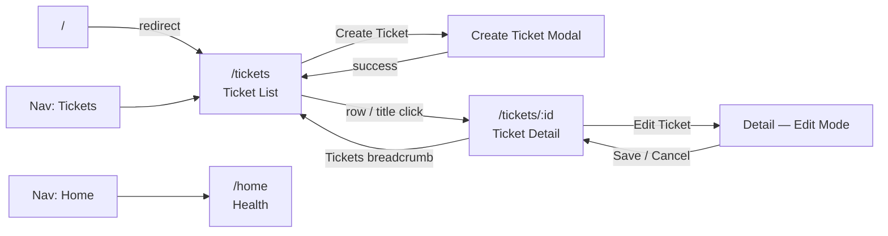
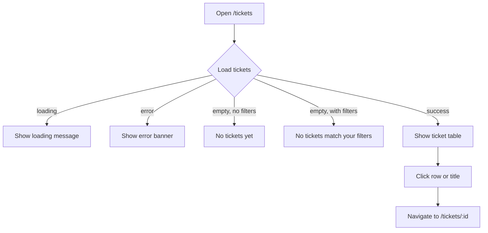
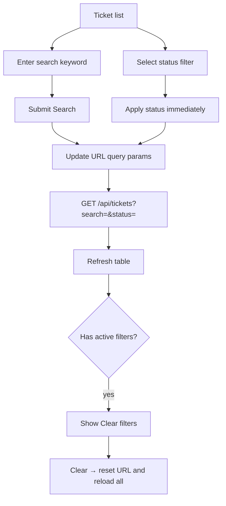
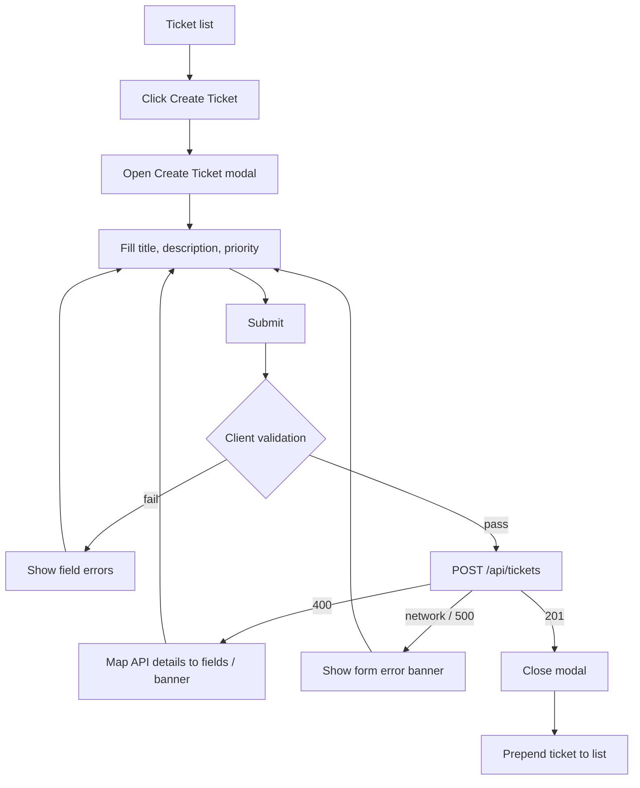
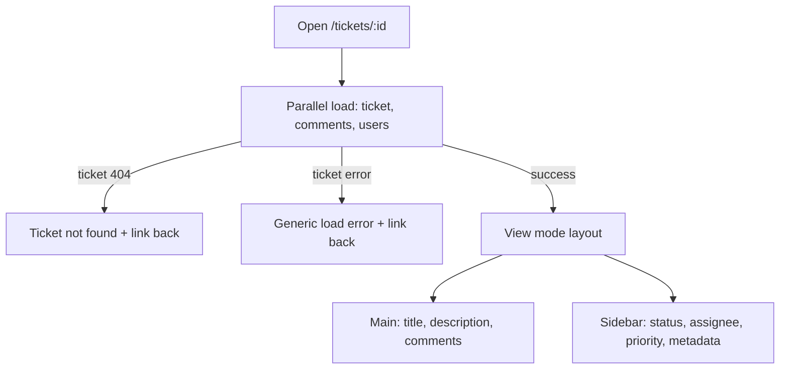
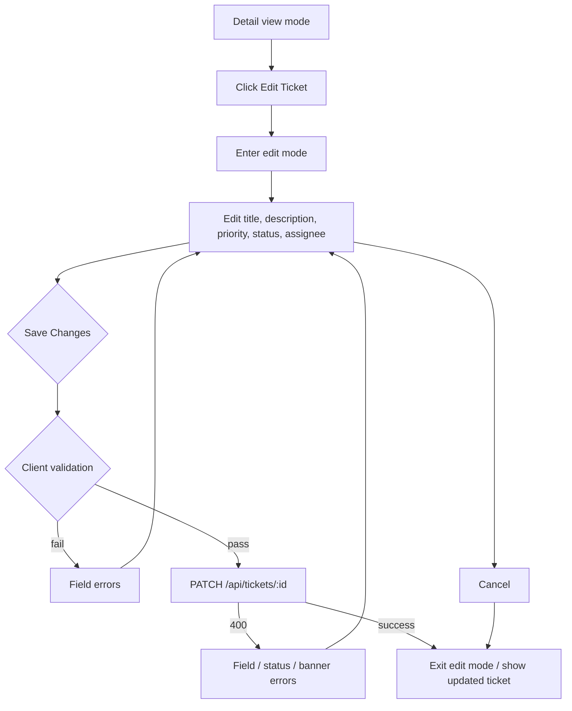
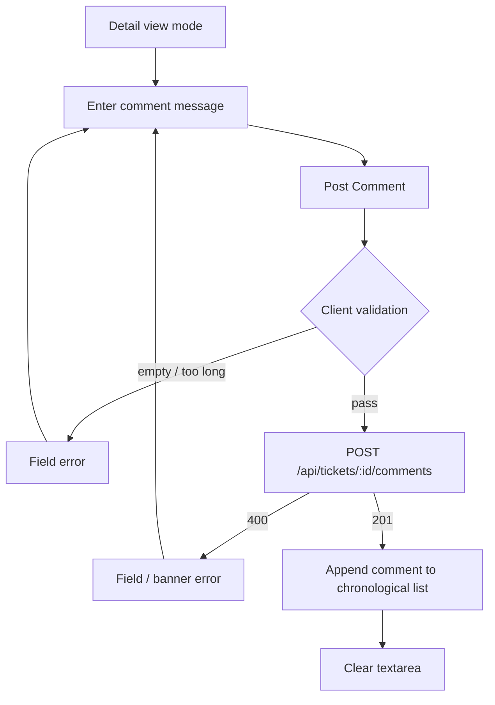
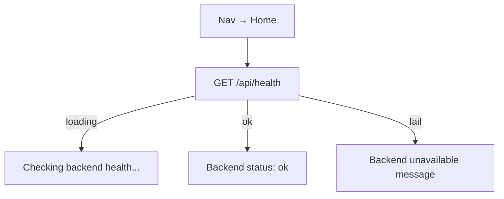
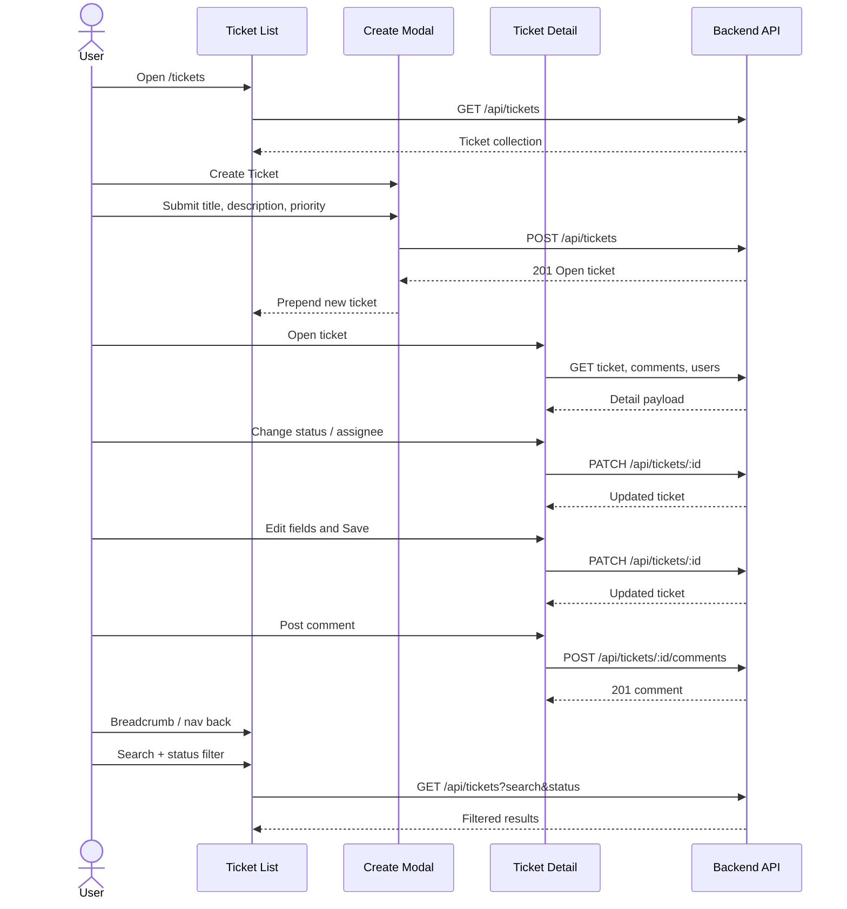

# UI Flow — Support Ticket Management System

> **Purpose:** Document the frontend screens, navigation paths, and primary user journeys as implemented in the React app.
>
> **Scope authority:** [acceptance-criteria.md](acceptance-criteria.md) governs feature scope. Backend rules in [requirement-analysis.md](requirement-analysis.md) remain the source of truth; the UI may hint at valid next statuses but does not solely enforce them.

---

## 1. Application Shell

| Element | Behavior |
|---------|----------|
| Header | App title: **Support Ticket Management** |
| Nav | `Tickets` → `/tickets`, `Home` → `/home` |
| Default route | `/` redirects to `/tickets` |

```text
┌──────────────────────────────────────────────────────────┐
│  Support Ticket Management     [Tickets]  [Home]         │
├──────────────────────────────────────────────────────────┤
│                                                          │
│                     <page content>                       │
│                                                          │
└──────────────────────────────────────────────────────────┘
```

---

## 2. Screens and Routes

| Route | Screen | Purpose |
|-------|--------|---------|
| `/` | Redirect | Navigates to ticket list |
| `/tickets` | Ticket list | Browse, search, filter, create tickets |
| `/tickets/:id` | Ticket detail | View, edit, assign, change status, comment |
| `/home` | Home / health | Welcome placeholder and API health status |

### Screen map



---

## 3. Primary User Journeys

### 3.1 Browse tickets



**List columns:** Title, Priority, Status, Assignee, Created, Updated.

### 3.2 Search and filter



| Control | Behavior |
|---------|----------|
| Search | Keyword on title/description; applied on form submit |
| Status | Dropdown (`All statuses` or a specific status); applied on change |
| Clear filters | Visible when search or status is active; resets both |
| URL state | Filters stored in `?search=` and `?status=` for shareable list views |

Search and status filters combine with **AND** logic on the backend.

### 3.3 Create ticket



| Field | Notes |
|-------|-------|
| Title | Required |
| Description | Required |
| Priority | Required (`Low`, `Medium`, `High`, `Critical`) |
| Status | Not set by user — server creates ticket as **Open** |

Modal dismiss: Cancel, close (×), Escape, or backdrop click (blocked while submitting).

### 3.4 View ticket detail



**View-mode sidebar actions (immediate save):**

- Change **Status** → `PATCH /api/tickets/:id` with `{ status }`
- Change **Assignee** → `PATCH /api/tickets/:id` with `{ assignedTo }` (`null` = Unassigned)

Invalid status transitions show an inline error under the status control (backend message).

### 3.5 Edit ticket fields



Edit mode keeps the same two-column layout. Status options that are not the current status or an allowed next status are **disabled** as a UX hint; the backend still validates every transition.

### 3.6 Add comment



Comments display oldest-first with author name and timestamp. Comment load failures are shown separately from ticket load failures.

### 3.7 Check API health (optional)



---

## 4. Status Workflow (UI Behavior)

Valid transitions (backend authority):

```text
Open        → In Progress | Cancelled
In Progress → Resolved | Cancelled
Resolved    → Closed
Closed      → (none — terminal)
Cancelled   → (none — terminal)
```

| UI behavior | Detail |
|-------------|--------|
| Hint | Status dropdown enables only current + allowed next statuses |
| Immediate change | View mode updates status on select |
| Edit mode | Status can change as part of Save Changes |
| Rejection | Backend `400` message shown under the status control or in the edit form |

Field updates (title, description, priority, assignee) remain allowed on **Closed** / **Cancelled** tickets; only further status changes are blocked.

---

## 5. Error and Empty States

| Scenario | Where shown | User action |
|----------|-------------|-------------|
| List load failure | Banner on ticket list | Retry by reloading / changing filters |
| No tickets | Empty state on list | Create a ticket |
| No filter matches | Empty state on list | Clear filters or adjust search |
| Ticket not found | Detail page | Back to tickets |
| Validation (create/edit/comment) | Field errors + optional banner | Correct fields and resubmit |
| Invalid status transition | Status field / form error | Choose an allowed next status |
| Assignee / users load failure | Assignee control error | Retry by reopening edit or reloading |
| Comments load failure | Comments section error | Ticket details still usable |
| Network / 500 | Form or page banner | Retry; no internal stack traces shown |

---

## 6. End-to-End Happy Path



---

## 7. Out of Scope (UI)

The following are not part of the current UI flow:

- Authentication / login
- User management screens
- Ticket or comment deletion
- Comment editing
- Pagination controls
- Assignment history or audit views

---

*Aligned with the implemented frontend (`frontend/src/App.jsx`, pages, and `CreateTicketModal`). Update this document when navigation or screen behavior changes.*
